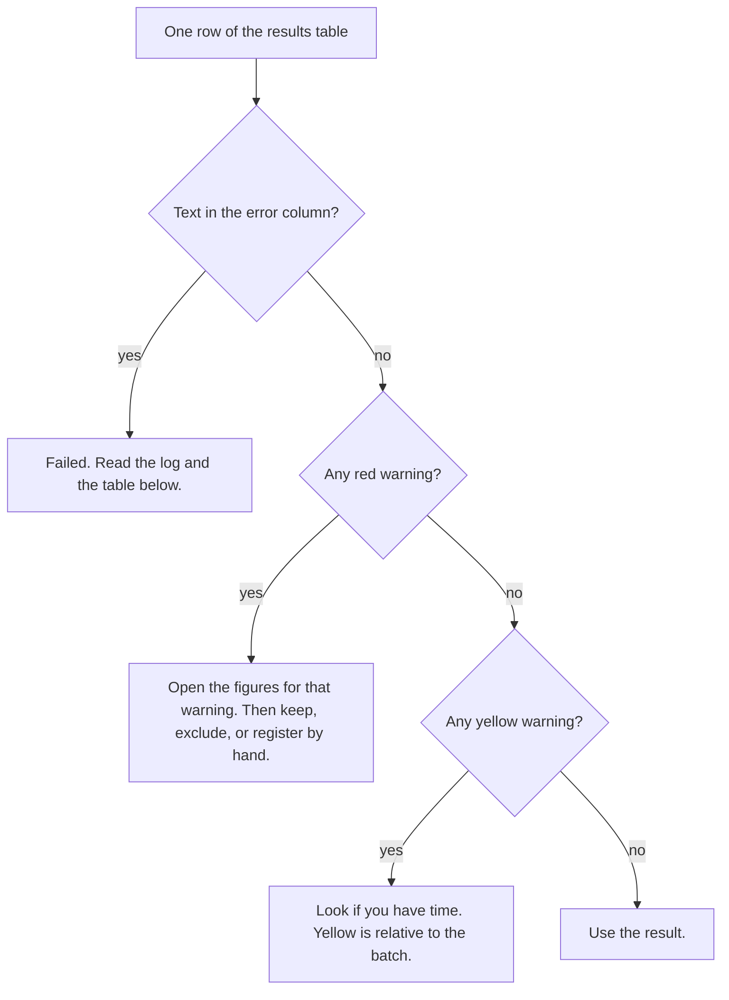

# CellRegBatch Guide

This guide takes you from the download to a checked batch. Part 2 runs the
sample data and takes about 5 minutes. The [Manual](MANUAL.md) gives the
details of each step.

CellRegBatch runs [CellReg](https://github.com/zivlab/CellReg) (Sheintuch et
al., 2017) on many animals. To understand what CellReg does and how to read
its figures, read the [CellReg User Manual](User%20Manual.docx).

**You need:**

- MATLAB R2020a or newer, with the Image Processing, Statistics and Machine
  Learning, and Optimization toolboxes. The Parallel Computing Toolbox is
  optional.
- For your own data: the spatial footprints of each session, for example from
  CNMF-E or Suite2p.

**Words used in this guide:** a *session* is one imaging session (one file).
A *dataset* is all sessions of one animal in one experiment. A *batch* is all
datasets in one folder.

## Part 1. Get the code

1. Download the repository. Use one of these:
   - `git clone https://github.com/iabs-neuro/CellRegBatch.git`
   - on GitHub, click **Code → Download ZIP** and unzip the file.
2. Start MATLAB.
3. Go to the repository folder, for example:
   `cd C:\tools\CellRegBatch`

You do not need to install anything. The GUI adds the necessary folders to
the MATLAB path when it starts.

To check the installation, run the tests (about 3 minutes):

```matlab
results = runtests('tests/BatchCellReg');
```

All tests must pass. One test is reported as *Incomplete*: it needs data that
is not in the repository. This is normal.

## Part 2. Run the sample data

The folder `SampleData/` contains the CellReg sample data: 5 sessions of one
mouse. The pixel size is 2.35 µm, the value in `CellReg/demo.m`. The batch
needs file names in the form `EXPERIMENT_ANIMAL_SESSION.mat`, so first make
copies with such names.

1. In the MATLAB Command Window, in the repository folder, run:

   ```matlab
   demo_in = fullfile(tempdir, 'CellRegBatch_demo');
   mkdir(demo_in);
   for k = 1:5
       copyfile(fullfile('SampleData', sprintf('spatial_footprints_%02d.mat', k)), ...
                fullfile(demo_in, sprintf('DEMO_M01_%dD.mat', k)));
   end
   disp(demo_in)
   ```

   MATLAB shows the path of a new folder. The folder contains
   `DEMO_M01_1D.mat` … `DEMO_M01_5D.mat`: experiment `DEMO`, animal `M01`,
   sessions `1D`–`5D`.

2. Start the GUI:

   ```matlab
   run BatchCellReg_GUI/BatchCellReg.m
   ```

3. On the **Setup** tab, click **Browse...** and select the folder from step 1.
4. Click **Scan**. The table shows one dataset, `DEMO_M01`, with 5 sessions.
   **Unparsed files** is 0.

   

5. On the **Parameters** tab, set **Microns per pixel** to `2.35`. Keep the
   other values.
6. If you do not have the Parallel Computing Toolbox, clear **Use parallel
   processing**.

   

7. On the **Run & Results** tab, click **Run batch**. Wait until the status
   next to the buttons says `done`. The log area shows each stage.
   On our computer this took about 2.5 minutes, without parallel processing.
8. Look at the result row. With MATLAB R2025b on Windows we got: **Cells**
   795, **%match** 0.4088, **FPR** 0.0061, all warnings 0. Other MATLAB
   versions can give slightly different numbers.
9. Click a warning cell. The line under the table explains the warning.

   

10. Click **Open output folder**. Open `DEMO_M01\Figures` and look at these
    CellReg figures:
    - `Stage 2 - pre vs post alignment.png`: the sessions before and after
      alignment.
    - `Stage 3 - model.png`: the model curves and the data histograms.
    - `Stage 5 - projcetions - final registration.png`: the registered cells.

    The CellReg User Manual explains each figure. The CellReg results for the
    same data, made with the CellReg settings, are in
    `SampleData/SampleResults/Figures/`.

With one dataset, the checks that compare datasets (W1, W2b_rel, W6b) cannot
run. They need at least 3 datasets.

## Part 3. Prepare your data

1. Save the spatial footprints of each session to a `.mat` file. The first
   variable in the file must be an N×Y×X array: N cells, Y pixels in height,
   X pixels in width. The `Helper/` folder has CellReg converters for Suite2p,
   CNMF-E and Inscopix outputs.
2. Name each file `EXPERIMENT_ANIMAL_SESSION.mat`. Examples:
   - `CC_H02_1D.mat`, `CC_H02_2D.mat`, … (experiment `CC`, animal `H02`)
   - `NOF_F07_1D_filters.mat` (text after the session is ignored)

   The animal ID has 1–2 letters and exactly 2 digits. The session has 1
   digit and `D` or `T`. [Manual, section 1.2](MANUAL.md#12-file-names) gives
   the full rule.
3. Put the files of all animals of one experiment in one folder. Do not use
   subfolders: the batch does not read them.
4. Check the session order. The batch sorts the files of each animal by
   name. The first session is the reference session.

## Part 4. Set the parameters

1. Set **Microns per pixel** for your microscope. A wrong value gives wrong
   distances and a poor model.
2. Keep **Maximal distance (um)** at 15, unless you have a reason to change
   it.
3. Set the expected number of sessions per animal. The GUI does not show
   this value, so use the config file:
   1. Click **Save config as...** and save a file, for example
      `my_experiment.json`.
   2. Open the file in a text editor. Change `"expected_n_sessions":5` to
      your number. Save the file.
   3. Click **Load config...** and select the file.
4. Keep the config file with your experiment. Next time, click **Load
   config...** to use the same settings. Each batch also saves its config as
   `_batch_config.json` in the output folder.

## Part 5. Run the batch

Caution: the batch overwrites the earlier results of the same datasets in the
output folder. To keep old results, copy them to another folder first.

1. On the **Setup** tab, click **Browse...** and select your data folder.
2. Click **Scan**.
3. Check the table:
   - each animal has the expected number of sessions;
   - **Unparsed files** is 0, or you know which files are not session files.
4. Clear **Run** for each animal that you do not want to process. Do not clear
   all of them: an empty selection runs all animals.
5. On the **Run & Results** tab, click **Run batch**.
6. To stop early, click **Stop**. The batch finishes the current animal and
   then stops.

If MATLAB runs out of memory, use fewer parallel workers. Before you click
**Run batch**, run `parpool(4)` in the Command Window. Or clear **Use parallel
processing**.

## Part 6. Check the results

The batch registers every animal it can. It does not decide which animals are
good. Use the warnings to find the animals that you must look at.



Open the dataset folder and the figure for each red warning:

| Warning | Figure in `<dataset>/Figures/` | Question |
|---|---|---|
| W3a low xcorr, W5a big shift | `Stage 2 - pre vs post alignment` | Do the cells of all sessions overlap after alignment? |
| W6a bad MSE, W6b MSE rel, W4 FPR unreach | `Stage 3 - model` | Do the model curves follow the histograms? |
| W1 %match, W2b ratio>3, W2b ratio rel | `Stage 1 - spatial footprints projections` | Is one session much sparser than the others? |
| W7 sess count | – | Is a session file missing or extra? |

[Manual, section 6](MANUAL.md#6-quality-warnings) gives the exact rule of
each warning. Note: with 5 sessions per animal, warnings W2, W3b and W5b
cannot fire. The manual explains why.

When a dataset looks wrong, you can:

- exclude it from the analysis;
- register it by hand in the CellReg GUI (`GUI/CellReg.m`) and check each
  stage.

**Failed datasets.** The `error` column and the log give the message.

| Message | Likely cause | Action |
|---|---|---|
| `All alignment modes failed ...` | A session does not show the same field of view as the reference session. | Look at the session. Remove it, or use another reference session. |
| `start parameter must satisfy bounds` or `Cannot fit a beta distribution ...` | CellReg cannot fit its model. In our data this happened in recordings with very few cells. | Exclude the dataset, or register it by hand. |

## Part 7. Use the registration

Each dataset folder has one `cellRegistered_*.mat` file. The batch saves the
CellReg result under the variable name `crs`. (The CellReg GUI uses the name
`cell_registered_struct`. The fields are the same.)

```matlab
f = dir(fullfile(demo_in, 'Matching', 'DEMO_M01', 'cellRegistered_*.mat'));
s = load(fullfile(f(1).folder, f(1).name));
map = s.crs.cell_to_index_map;       % registered cells x sessions
in_all = sum(all(map > 0, 2))        % cells found in all sessions
```

`map(i, j)` is the number of registered cell `i` in session `j`, in the order
of the footprints in that session's input file. 0 means that the cell was not
found in that session. [Manual, section 7](MANUAL.md#7-using-the-results)
shows two ways to compute the fraction of tracked cells.

## Part 8. Look at an earlier batch again

1. Start the GUI.
2. On the **Run & Results** tab, click **Load results CSV...**.
3. Select `_batch_results.csv` in the output folder.

The table shows the results and the warnings again.

## Problems and solutions

| Problem | Cause | Solution |
|---|---|---|
| **Unparsed files** is more than 0 | Some file names do not match the rule. | Rename the files (Part 3). |
| An animal has **Run** cleared after **Scan** | It has fewer than 2 sessions, or two files with the same session. | Read the log. See [Manual, section 1.4](MANUAL.md#14-datasets-that-are-skipped). |
| A file `_batch_results_<time>.csv` appears | `_batch_results.csv` was open in another program. | Close the file in Excel before you run the batch. |
| An error about `gcp` or `parpool` | The Parallel Computing Toolbox is not installed. | Clear **Use parallel processing**. |
| MATLAB runs out of memory | Each parallel worker keeps its own data. | Run `parpool(4)` first, or clear **Use parallel processing**. |
| The GUI does not respond after a file dialog | The dialog window took the focus. | Click the GUI window. |
