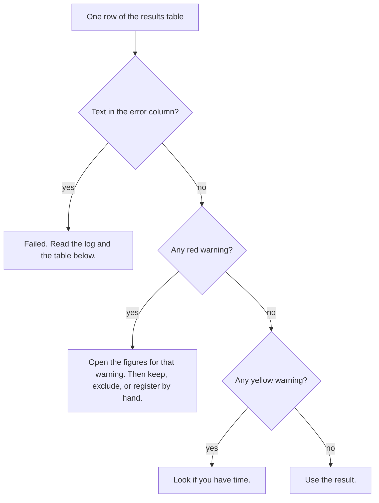

# CellRegBatch Guide

This guide takes you from the download to a checked batch. Part 2 runs the
sample data and takes about 5 minutes. The [Manual](MANUAL.md) gives the
details of each step. Русская версия: [GUIDE_ru.md](GUIDE_ru.md).

CellRegBatch runs [CellReg](https://github.com/zivlab/CellReg) (Sheintuch et
al., 2017) on many animals. To understand what CellReg does and how to read
its figures, read the [CellReg User Manual](User%20Manual.docx).

**You need:**

- MATLAB R2020a or newer, with the Image Processing, Statistics and Machine
  Learning, and Optimization toolboxes. The Parallel Computing Toolbox is
  optional.
- For your own data: the spatial footprints of each session, for example from
  CNMF-E or Suite2p.

**Words used in this guide:** a *session* is one imaging session (one file).
A *dataset* is all sessions of one animal in one experiment. A *batch* is all
datasets in one folder.

## Part 1. Get the code

1. Download the repository. Use one of these:
   - `git clone https://github.com/iabs-neuro/CellRegBatch.git`
   - on GitHub, click **Code → Download ZIP** and unzip the file.
2. Start MATLAB.
3. Go to the repository folder, for example:
   `cd C:\tools\CellRegBatch`

You do not need to install anything. The GUI adds the necessary folders to
the MATLAB path when it starts.

To check the installation, run the tests (about 7 minutes):

```matlab
results = runtests('tests/BatchCellReg');
```

All tests must pass. One test is reported as *Incomplete*: it needs data that
is not in the repository. This is normal.

## Part 2. Run the sample data

The folder `SampleData/` contains the CellReg sample data: 5 sessions of one
mouse. The pixel size is 2.35 µm, the value in `CellReg/demo.m`. The batch
needs file names in the form `EXPERIMENT_ANIMAL_SESSION.mat`, so first make
copies with such names.

1. In the MATLAB Command Window, in the repository folder, run:

   ```matlab
   demo_in = fullfile(tempdir, 'CellRegBatch_demo');
   mkdir(demo_in);
   for k = 1:5
       copyfile(fullfile('SampleData', sprintf('spatial_footprints_%02d.mat', k)), ...
                fullfile(demo_in, sprintf('DEMO_M01_%dD.mat', k)));
   end
   disp(demo_in)
   ```

   MATLAB shows the path of a new folder. The folder contains
   `DEMO_M01_1D.mat` … `DEMO_M01_5D.mat`: experiment `DEMO`, animal `M01`,
   sessions `1D`–`5D`.

2. Start the GUI:

   ```matlab
   run BatchCellReg_GUI/BatchCellReg.m
   ```

3. On the **Setup** tab, click **Browse...** and select the folder from step 1.
4. Click **Scan**. The table shows one dataset, `DEMO_M01`, with 5 sessions.
   **Expected sessions per mouse** is 5, so **Check** says `OK`.
   **Unparsed files** is 0. The **?** buttons explain each field.

   

5. On the **Parameters** tab, set **Microns per pixel** to `2.35`. Keep the
   other values.
6. If you do not have the Parallel Computing Toolbox, clear **Use parallel
   processing**.

   

7. On the **Run & Results** tab, click **Run batch**. Wait until the status
   next to the buttons says `done`. The log area shows each stage.
   On our computer this took about 2.5 minutes, without parallel processing.
8. Look at the result row. With MATLAB R2025b on Windows we got: **Cells**
   795, **Match %** 58.3, **FPR %** 0.61, no coloured warning. Other MATLAB
   versions can give slightly different numbers.
9. Click a warning cell. The area under the table explains the warning.
   Click **Warnings figure** to see the picture of all warnings.

   

10. Click **Open output folder**. Open `DEMO_M01\Figures` and look at these
    CellReg figures:
    - `Stage 2 - pre vs post alignment.png`: the sessions before and after
      alignment.
    - `Stage 3 - model.png`: the model curves and the data histograms.
    - `Stage 5 - projcetions - final registration.png`: the registered cells.

    The CellReg User Manual explains each figure. The CellReg results for the
    same data, made with the CellReg settings, are in
    `SampleData/SampleResults/Figures/`.

**Without the GUI.** After step 1, run this instead of steps 2–9. It prints
the batch log in the Command Window.

```matlab
addpath(genpath('CellReg')); addpath(genpath('Helper')); addpath(genpath('BatchCellReg'));
cfg = batch_default_config();
cfg.cellreg.microns_per_pixel = 2.35;
cfg.cellreg.use_parallel_processing = false;
summary = batch_run(demo_in, cfg);
summary.results(1).match_stats(1:2)      % registered cells, cells in all sessions
```

[Manual, section 2.2](MANUAL.md#22-script) describes the script interface.

With one dataset, the **Low match** warning cannot compare the dataset with
the batch. The comparison needs at least 5 datasets with the expected number
of sessions.

## Part 3. Prepare your data

1. Save the spatial footprints of each session to a `.mat` file. The first
   variable in the file must be an N×Y×X array: N cells, Y pixels in height,
   X pixels in width. The `Helper/` folder has CellReg converters for Suite2p,
   CNMF-E and Inscopix outputs. For CaImAn, use the Python code in
   [Manual, section 1.1](MANUAL.md#11-file-content).
2. Name each file `EXPERIMENT_ANIMAL_SESSION.mat`. Examples:
   - `CC_H02_1D.mat`, `CC_H02_2D.mat`, … (experiment `CC`, animal `H02`)
   - `NOF_F07_1D_filters.mat` (text after the session is ignored)

   The animal ID has 1–2 letters and exactly 2 digits. The session has 1
   digit and `D` or `T`. [Manual, section 1.2](MANUAL.md#12-file-names) gives
   the full rule.
3. Put the files of all animals of one experiment in one folder. Do not use
   subfolders: the batch does not read them.
4. Check the session order. The batch sorts the files of each animal by
   name. The first session is the reference session. To change the order,
   rename the files.
5. If an animal has no file for a session, do not make an empty file. The
   batch matches the sessions that the animal has and marks the missing ones
   (Part 5).

## Part 4. Set the parameters

1. Set **Microns per pixel** for your microscope. A wrong value gives wrong
   distances and a poor model. The default 1.6 is the value of our setup, not
   of yours.
2. Keep **Maximal distance (um)** at 15, unless you have a reason to change
   it.
3. Keep **Registration model** at `auto`. CellReg then chooses the model
   with the better fit for each animal. Set `Spatial correlation` or
   `Centroid distance` only if you need the same model for all animals.
4. Keep the warning limits in the right column. Click **?** next to a limit
   to see what it means.
5. Click **Save config as...** and keep the file with your experiment. Next
   time, click **Load config...** to use the same settings. Each batch also
   saves its config as `_batch_config.json` in the output folder. The config
   also holds **Expected sessions per mouse** from the **Setup** tab.

## Part 5. Run the batch

Caution: the batch overwrites the earlier results of the same datasets in the
output folder. To keep old results, copy them to another folder first.

1. On the **Setup** tab, click **Browse...** and select your data folder.
2. Click **Scan**.
3. Set **Expected sessions per mouse** to the number of sessions of your
   experiment.
4. Read the line under it. It lists the session names of the folder and how
   many animals do not have the expected number.
5. Check the table:
   - **Check** is `OK` for each animal. A red cell says what is different,
     for example `4 of 5: no 3D`;
   - **Unparsed files** is 0, or you know which files are not session files.
6. Decide what to do with each animal that has a red **Check** cell:
   - to match it, keep **Run** set. The batch matches its sessions and gives
     it a red **Sessions** warning. Its cell map has a column of zeros for
     each missing session, so it has the same columns as the other maps;
   - to skip it, clear **Run**.
7. Clear **Run** for each other animal that you do not want to process.
8. On the **Run & Results** tab, click **Run batch**.
9. To stop early, click **Stop**. The batch finishes the current animal and
   then stops.

You can run the batch again for some animals only, for example after you fix
their files. The tables and the figure still show the other animals of
earlier runs. To start from nothing, delete the output folder.

If MATLAB runs out of memory, use fewer parallel workers. Before you click
**Run batch**, run `parpool(4)` in the Command Window. Or clear **Use parallel
processing**.

## Part 6. Check the results

The batch registers every animal it can. It does not decide which animals are
good. Use the warnings to find the animals that you must look at.



Start with the picture of the whole batch: click **Warnings figure**, or open
`_batch_warnings.png` in the output folder. The grid on the left shows the
warnings of each animal. The panels on the right show the values and the
limits.


*Example: the CellReg sample mouse (M01) and five modified copies of it. M02 has no session 3D. M03 lost 70 % of the cells of session 4D. M04 keeps 45 random cells per session. Session 3D of M05 is shifted by 45 px. Session 5D of M06 is mirrored, so it shows another field of view.*

Then open the dataset folder and the figure for each red warning:

| Warning | Figure in `<dataset>/Figures/` | Question |
|---|---|---|
| Sessions | – | Is a session file missing or extra? |
| Few cells | `Stage 1 - spatial footprints projections` | Are there enough cells for reliable statistics? |
| Cell drop | `Stage 1 - spatial footprints projections` | Is one session much sparser than the others? Check its recording and curation. |
| Alignment | `Stage 2 - pre vs post alignment` | Do the cells of all sessions overlap after alignment? |
| Model fit | `Stage 3 - model` | Do the model curves follow the histograms? |
| Low match | `Stage 2 - pre vs post alignment`, `Stage 5 - projcetions - final registration` | If the detail names a session: does it show the same field of view as the others? Else: are few cells tracked across all sessions? Look for one of the causes above. |

[Manual, section 6](MANUAL.md#6-quality-warnings) gives the exact rule of
each warning. For each fired rule, `_batch_warnings_detail.csv` gives the
session, the value and the limit. Click a warning cell in the GUI to see the
same text.

When a dataset looks wrong, you can:

- exclude it from the analysis;
- register it by hand in the CellReg GUI (`GUI/CellReg.m`) and check each
  stage.

**Failed datasets.** The `error` column and the log give the message.

| Message | Likely cause | Action |
|---|---|---|
| `All alignment modes failed ...` | A session does not show the same field of view as the reference session. | Look at the session. Remove it, or use another reference session. |
| `...: the first variable, ..., is a ... Expected spatial footprints as a 3-D array ...` | The file does not hold N×Y×X footprints, for example a pixels × cells matrix. | Convert the file (Part 3, step 1). |
| `start parameter must satisfy bounds` or `Cannot fit a beta distribution ...` | CellReg cannot fit its model. In our data this happened in recordings with very few cells. | Exclude the dataset, or register it by hand. |

## Part 7. Use the registration

Each dataset folder has one `cellRegistered_*.mat` file. It holds the CellReg
result in the variable `cell_registered_struct`, as in the CellReg GUI.

```matlab
f = dir(fullfile(demo_in, 'Matching', 'DEMO_M01', 'cellRegistered_*.mat'));
s = load(fullfile(f(1).folder, f(1).name));
map = s.cell_registered_struct.cell_to_index_map;   % registered cells x sessions
in_all = sum(all(map > 0, 2))                         % cells found in all sessions
```

`map(i, j)` is the number of registered cell `i` in session `j`, in the order
of the footprints in the input file of that session. 0 means that the cell was
not found in that session.

The output folder also has two tables for the whole batch:

- `<animal>_cellmap.csv`, for example `DEMO_M01_cellmap.csv`: the same map as
  a CSV file. Use it in Python, R or Excel. All maps of a batch have one
  column for each session name of the folder. A missing session is a column
  of zeros.
- `_match_statistics.csv`: for each animal, the number of cells found in all
  sessions, in all sessions but one, and so on down to one session. It also
  gives two percentages of tracked cells.
  [Manual, section 5.3](MANUAL.md#53-_match_statisticscsv) explains the
  columns.

## Part 8. Look at an earlier batch again

1. Start the GUI.
2. On the **Run & Results** tab, click **Load results CSV...**.
3. Select `_batch_results.csv` in the output folder.

The table shows the results and the warnings again.

## Problems and solutions

| Problem | Cause | Solution |
|---|---|---|
| **Unparsed files** is more than 0 | Some file names do not match the rule. | Rename the files (Part 3). |
| An animal has **Run** cleared after **Scan** | It has fewer than 2 sessions, or two files with the same session. | Read the log. See [Manual, section 1.4](MANUAL.md#14-datasets-that-are-skipped). |
| A red **Check** cell after **Scan** | The animal has another number of sessions than **Expected sessions per mouse**. | Check the file names. Keep **Run** to match it with a red **Sessions** warning, or clear **Run**. |
| The session line lists more session names than expected | Animals use different session names, for example `1D` and `1T`. | Rename the files so that all animals use the same session names. |
| **Load results CSV...** says "older version" | The file was made before the warnings review. | Run the batch again. |
| A script run ends with 0 datasets and the warning `No dataset found` | No file name matches the rule. The log lists the files. | Rename the files (Part 3). |
| A file `_batch_results_<time>.csv` appears | `_batch_results.csv` was open in another program. | Close the file in Excel before you run the batch. |
| An error about `gcp` or `parpool` | The Parallel Computing Toolbox is not installed. | Clear **Use parallel processing**. |
| MATLAB runs out of memory | Each parallel worker keeps its own data. | Run `parpool(4)` first, or clear **Use parallel processing**. |
| The GUI does not respond after a file dialog | The dialog window took the focus. | Click the GUI window. |
