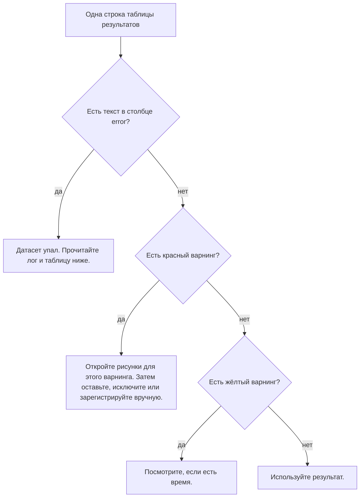

# CellRegBatch: руководство

Руководство ведёт от скачивания кода до проверенного батча. Часть 2 — прогон
на демонстрационных данных, около 5 минут. Подробности каждого шага — в
[справочнике](MANUAL_ru.md). English version: [GUIDE.md](GUIDE.md),
[MANUAL.md](MANUAL.md).

CellRegBatch запускает [CellReg](https://github.com/zivlab/CellReg)
(Sheintuch et al., 2017) на многих животных подряд. Что делает CellReg и как
читать его рисунки, описано в [CellReg User Manual](User%20Manual.docx).

**Что нужно:**

- MATLAB R2020a или новее с тулбоксами Image Processing, Statistics and
  Machine Learning и Optimization. Parallel Computing Toolbox не обязателен.
- Для своих данных: пространственные фильтры (spatial footprints) клеток
  каждой сессии, например из CNMF-E или Suite2p.

**Термины:**

| Термин | Значение |
|---|---|
| сессия | Одна сессия записи. Один входной файл. |
| датасет | Все сессии одного животного в одном эксперименте. |
| батч | Все датасеты в одной папке. |
| референсная сессия | Сессия, к которой выравниваются остальные. |

## Часть 1. Скачайте код

1. Скачайте репозиторий одним из способов:
   - `git clone https://github.com/iabs-neuro/CellRegBatch.git`
   - на GitHub нажмите **Code → Download ZIP** и распакуйте архив.
2. Запустите MATLAB.
3. Перейдите в папку репозитория, например:
   `cd C:\tools\CellRegBatch`

Устанавливать ничего не нужно. GUI сам добавляет нужные папки в путь MATLAB
при запуске.

Чтобы проверить установку, запустите тесты (около 7 минут):

```matlab
results = runtests('tests/BatchCellReg');
```

Все тесты должны пройти. Один тест получает статус *Incomplete*: ему нужны
данные, которых нет в репозитории. Это нормально.

## Часть 2. Прогоните демонстрационные данные

В папке `SampleData/` лежат демонстрационные данные CellReg: 5 сессий одной
мыши. Размер пикселя 2,35 мкм, как в `CellReg/demo.m`. Батчу нужны имена
файлов вида `ЭКСПЕРИМЕНТ_ЖИВОТНОЕ_СЕССИЯ.mat`. Поэтому сначала сделайте копии
с такими именами.

1. В Command Window MATLAB, в папке репозитория, выполните:

   ```matlab
   demo_in = fullfile(tempdir, 'CellRegBatch_demo');
   mkdir(demo_in);
   for k = 1:5
       copyfile(fullfile('SampleData', sprintf('spatial_footprints_%02d.mat', k)), ...
                fullfile(demo_in, sprintf('DEMO_M01_%dD.mat', k)));
   end
   disp(demo_in)
   ```

   MATLAB покажет путь к новой папке. В ней лежат файлы
   `DEMO_M01_1D.mat` … `DEMO_M01_5D.mat`: эксперимент `DEMO`, животное `M01`,
   сессии `1D`–`5D`.

2. Запустите GUI:

   ```matlab
   run BatchCellReg_GUI/BatchCellReg.m
   ```

3. На вкладке **Setup** нажмите **Browse...** и выберите папку из шага 1.
4. Нажмите **Scan**. В таблице появится один датасет, `DEMO_M01`, с 5
   сессиями. **Expected sessions per mouse** равно 5, поэтому в столбце
   **Check** стоит `OK`. **Unparsed files** равно 0. Кнопки **?** объясняют
   каждое поле.

   

5. На вкладке **Parameters** задайте **Microns per pixel** = `2.35`.
   Остальные значения не меняйте.
6. Если у вас нет Parallel Computing Toolbox, снимите галочку **Use parallel
   processing**.

   

7. На вкладке **Run & Results** нажмите **Run batch**. Дождитесь, пока статус
   рядом с кнопками сменится на `done`. В окне лога видно каждый этап.
   На нашем компьютере без параллельной обработки это заняло около 2,5 минут.
8. Посмотрите на строку результата. В MATLAB R2025b под Windows у нас
   получилось: **Cells** 795, **Match %** 58.3, **FPR %** 0.61, ни одного
   цветного варнинга. В других версиях MATLAB числа могут немного отличаться.
9. Щёлкните ячейку варнинга. Поле под таблицей объяснит этот варнинг.
   Нажмите **Warnings figure**, чтобы увидеть картинку со всеми варнингами.

   

10. Нажмите **Open output folder**. Откройте `DEMO_M01\Figures` и посмотрите
    рисунки CellReg:
    - `Stage 2 - pre vs post alignment.png`: сессии до и после выравнивания.
    - `Stage 3 - model.png`: кривые модели и гистограммы данных.
    - `Stage 5 - projcetions - final registration.png`: найденные клетки.

    Каждый рисунок объяснён в CellReg User Manual. Рисунки CellReg для тех
    же данных с настройками CellReg лежат в
    `SampleData/SampleResults/Figures/`.

**Без GUI.** После шага 1 выполните вместо шагов 2–9 этот код. Он печатает
лог батча в Command Window.

```matlab
addpath(genpath('CellReg')); addpath(genpath('Helper')); addpath(genpath('BatchCellReg'));
cfg = batch_default_config();
cfg.cellreg.microns_per_pixel = 2.35;
cfg.cellreg.use_parallel_processing = false;
summary = batch_run(demo_in, cfg);
summary.results(1).match_stats(1:2)      % клетки всего, клетки во всех сессиях
```

Скриптовый интерфейс описан в
[справочнике, раздел 2.2](MANUAL_ru.md#22-скрипт).

С одним датасетом варнинг **Low match** не может сравнить датасет с батчем.
Для сравнения нужно не меньше 5 датасетов с ожидаемым числом сессий.

## Часть 3. Подготовьте свои данные

1. Сохраните фильтры каждой сессии в `.mat` файл. Первая переменная в файле —
   массив N×Y×X: N клеток, Y пикселей по высоте, X пикселей по ширине. В папке
   `Helper/` есть конвертеры CellReg для выходов Suite2p, CNMF-E и Inscopix.
   Для CaImAn используйте код на Python из
   [справочника, раздел 1.1](MANUAL_ru.md#11-содержимое-файла).
2. Назовите каждый файл `ЭКСПЕРИМЕНТ_ЖИВОТНОЕ_СЕССИЯ.mat`. Примеры:
   - `CC_H02_1D.mat`, `CC_H02_2D.mat`, … (эксперимент `CC`, животное `H02`)
   - `NOF_F07_1D_filters.mat` (текст после сессии не учитывается)

   ID животного — 1–2 латинские буквы и ровно 2 цифры. Сессия — 1 цифра и
   `D` или `T`. Полное правило — в
   [справочнике, раздел 1.2](MANUAL_ru.md#12-имена-файлов).
3. Положите файлы всех животных одного эксперимента в одну папку. Не
   используйте подпапки: батч их не читает.
4. Проверьте порядок сессий. Батч сортирует файлы каждого животного по имени.
   Первая сессия становится референсной. Чтобы изменить порядок,
   переименуйте файлы.
5. Если у животного нет файла какой-то сессии, не создавайте пустой файл. Батч
   сметчит те сессии, что есть, и отметит пропущенные (часть 5).

## Часть 4. Задайте параметры

1. Задайте **Microns per pixel** для вашего микроскопа. Неверное значение
   даёт неверные расстояния и плохую модель. Значение по умолчанию 1.6 —
   от нашей установки, а не от вашей.
2. Оставьте **Maximal distance (um)** = 15, если нет причины его менять.
3. Оставьте **Registration model** = `auto`. Тогда CellReg для каждого
   животного выберет модель, которая лучше подходит. Задавайте
   `Spatial correlation` или `Centroid distance`, только если нужна одна
   модель для всех животных.
4. Пороги варнингов в правой колонке не меняйте. Кнопка **?** рядом с порогом
   объясняет его смысл.
5. Нажмите **Save config as...** и храните файл вместе с экспериментом. В
   следующий раз нажмите **Load config...**, чтобы взять те же настройки.
   Каждый батч также сохраняет свой конфиг как `_batch_config.json` в
   выходной папке. В конфиг входит и **Expected sessions per mouse** с
   вкладки **Setup**.

## Часть 5. Запустите батч

Внимание: батч перезаписывает прежние результаты тех же датасетов в выходной
папке. Чтобы сохранить старые результаты, сначала скопируйте их в другую
папку.

1. На вкладке **Setup** нажмите **Browse...** и выберите папку с данными.
2. Нажмите **Scan**.
3. Задайте **Expected sessions per mouse** — число сессий в вашем
   эксперименте.
4. Прочитайте строку под этим полем. В ней названия сессий из папки и число
   животных, у которых сессий не столько, сколько ожидалось.
5. Проверьте таблицу:
   - в столбце **Check** у каждого животного `OK`. Красная ячейка говорит,
     что не так, например `4 of 5: no 3D`;
   - **Unparsed files** равно 0, или вы знаете, какие файлы не являются
     файлами сессий.
6. Решите, что делать с каждым животным с красной ячейкой **Check**:
   - чтобы сметчить его, оставьте галочку **Run**. Батч сметчит его сессии и
     поставит красный варнинг **Sessions**. В его карте клеток на месте
     каждой пропущенной сессии будет столбец нулей, поэтому столбцы совпадут
     с картами остальных животных;
   - чтобы пропустить его, снимите галочку **Run**.
7. Снимите галочку **Run** у остальных животных, которых не нужно
   обрабатывать.
8. На вкладке **Run & Results** нажмите **Run batch**.
9. Чтобы остановить батч раньше, нажмите **Stop**. Батч закончит текущее
   животное и остановится.

Батч можно перезапустить только для части животных, например после
исправления их файлов. Таблицы и картинка по-прежнему покажут остальных
животных из прежних прогонов. Чтобы начать с нуля, удалите выходную папку.

Если MATLAB не хватает памяти, уменьшите число параллельных воркеров. Перед
**Run batch** выполните в Command Window `parpool(4)`. Или снимите галочку
**Use parallel processing**.

## Часть 6. Проверьте результаты

Батч регистрирует каждое животное, какое может. Он не решает, какие животные
хорошие. Варнинги показывают, на каких животных нужно посмотреть самому.



Начните с картинки всего батча: нажмите **Warnings figure** или откройте
`_batch_warnings.png` в выходной папке. Сетка слева показывает варнинги
каждого животного. Панели справа показывают значения и пороги.


*Пример: демо-мышь CellReg (M01) и пять её изменённых копий. У M02 нет сессии 3D. M03 потеряла 70 % клеток сессии 4D. У M04 по 45 случайных клеток в сессии. Сессия 3D у M05 сдвинута на 45 px. Сессия 5D у M06 отражена зеркально, то есть показывает другое поле зрения.*

Затем для каждого красного варнинга откройте папку датасета и нужный рисунок:

| Варнинг | Рисунок в `<датасет>/Figures/` | Вопрос |
|---|---|---|
| Sessions | – | Не пропущен ли файл сессии, нет ли лишнего? |
| Few cells | `Stage 1 - spatial footprints projections` | Хватает ли клеток для надёжной статистики? |
| Cell drop | `Stage 1 - spatial footprints projections` | Нет ли сессии с намного меньшим числом клеток? Проверьте её запись и курацию. |
| Alignment | `Stage 2 - pre vs post alignment` | Совпадают ли клетки всех сессий после выравнивания? |
| Model fit | `Stage 3 - model` | Идут ли кривые модели по гистограммам? |
| Low match | `Stage 2 - pre vs post alignment`, `Stage 5 - projcetions - final registration` | Если в деталях названа сессия: то же ли в ней поле зрения, что в остальных? Иначе: мало ли клеток прослежено через все сессии? Ищите одну из причин выше. |

Точное правило каждого варнинга — в
[справочнике, раздел 6](MANUAL_ru.md#6-варнинги). Для каждого сработавшего
правила файл `_batch_warnings_detail.csv` называет сессию, значение и порог.
Тот же текст GUI показывает по щелчку на ячейку варнинга.

Если датасет выглядит плохо, можно:

- исключить его из анализа;
- зарегистрировать его вручную в GUI CellReg (`GUI/CellReg.m`) и проверить
  каждый этап.

**Упавшие датасеты.** Сообщение об ошибке — в столбце `error` и в логе.

| Сообщение | Вероятная причина | Что делать |
|---|---|---|
| `All alignment modes failed ...` | Сессия показывает не то же поле зрения, что референсная. | Посмотрите на сессию. Уберите её или выберите другую референсную сессию. |
| `...: the first variable, ..., is a ... Expected spatial footprints as a 3-D array ...` | В файле не фильтры N×Y×X, а, например, матрица пиксели × клетки. | Сконвертируйте файл (часть 3, шаг 1). |
| `start parameter must satisfy bounds` или `Cannot fit a beta distribution ...` | CellReg не может подогнать модель. У нас это было в записях с очень малым числом клеток. | Исключите датасет или зарегистрируйте его вручную. |

## Часть 7. Используйте регистрацию

В папке каждого датасета лежит один файл `cellRegistered_*.mat`. В нём
результат CellReg в переменной `cell_registered_struct`, как у GUI CellReg.

```matlab
f = dir(fullfile(demo_in, 'Matching', 'DEMO_M01', 'cellRegistered_*.mat'));
s = load(fullfile(f(1).folder, f(1).name));
map = s.cell_registered_struct.cell_to_index_map;   % клетки x сессии
in_all = sum(all(map > 0, 2))                         % клетки, найденные во всех сессиях
```

`map(i, j)` — номер клетки `i` в сессии `j`, в порядке фильтров во входном
файле этой сессии. 0 значит, что в этой сессии клетка не найдена.

В выходной папке есть ещё две таблицы на весь батч:

- `<животное>_cellmap.csv`, например `DEMO_M01_cellmap.csv`: та же карта в
  виде CSV. Её можно открыть в Python, R или Excel. У всех карт батча по
  одному столбцу на каждое название сессии из папки. Пропущенная сессия —
  столбец нулей.
- `_match_statistics.csv`: для каждого животного число клеток, найденных во
  всех сессиях, во всех кроме одной, и так далее до одной сессии. В ней же два
  процента отслеженных клеток. Столбцы описаны в
  [справочнике, раздел 5.3](MANUAL_ru.md#53-_match_statisticscsv).

## Часть 8. Посмотрите прежний батч

1. Запустите GUI.
2. На вкладке **Run & Results** нажмите **Load results CSV...**.
3. Выберите `_batch_results.csv` в выходной папке.

Таблица снова покажет результаты и варнинги.

## Проблемы и решения

| Проблема | Причина | Решение |
|---|---|---|
| **Unparsed files** больше 0 | Имена некоторых файлов не подходят под правило. | Переименуйте файлы (часть 3). |
| После **Scan** у животного снята галочка **Run** | У него меньше 2 сессий или два файла с одной сессией. | Прочитайте лог. См. [справочник, раздел 1.4](MANUAL_ru.md#14-датасеты-которые-пропускаются). |
| После **Scan** красная ячейка **Check** | У животного не столько сессий, сколько задано в **Expected sessions per mouse**. | Проверьте имена файлов. Оставьте **Run**, чтобы сметчить его с красным варнингом **Sessions**, или снимите галочку. |
| В строке сессий больше названий, чем ожидалось | Животные используют разные названия сессий, например `1D` и `1T`. | Переименуйте файлы, чтобы у всех животных были одинаковые названия сессий. |
| **Load results CSV...** пишет «older version» | Файл сделан до пересмотра варнингов. | Запустите батч заново. |
| Скрипт закончился с 0 датасетов и предупреждением `No dataset found` | Ни одно имя файла не подходит под правило. Лог перечисляет файлы. | Переименуйте файлы (часть 3). |
| Появился файл `_batch_results_<время>.csv` | `_batch_results.csv` был открыт в другой программе. | Закройте файл в Excel перед запуском батча. |
| Ошибка про `gcp` или `parpool` | Не установлен Parallel Computing Toolbox. | Снимите галочку **Use parallel processing**. |
| MATLAB не хватает памяти | Каждый параллельный воркер держит свою копию данных. | Сначала выполните `parpool(4)` или снимите галочку **Use parallel processing**. |
| GUI не реагирует после окна выбора файла | Окно диалога забрало фокус. | Щёлкните окно GUI. |
