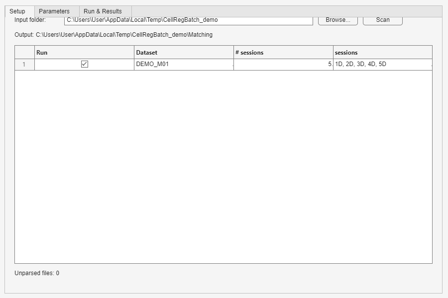
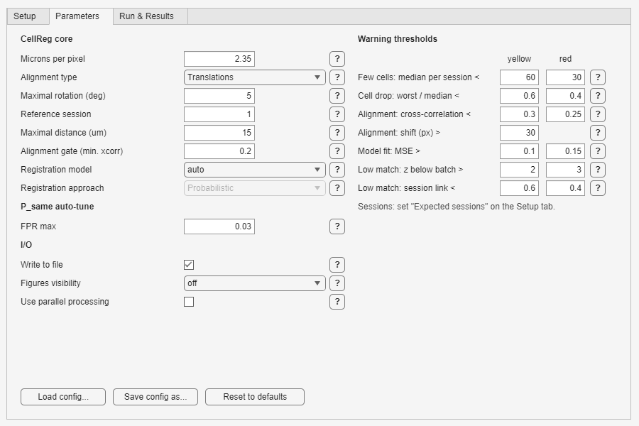
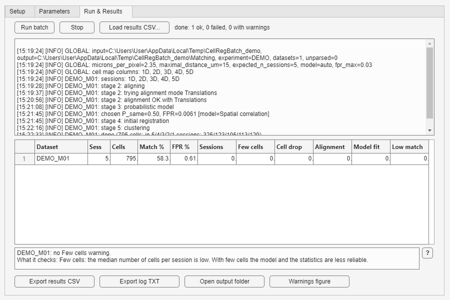
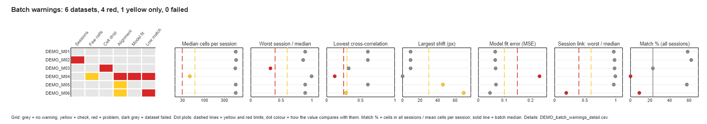

# CellRegBatch Manual

This manual is the reference for the batch layer of CellRegBatch. It describes
what the code does, step by step, and every file and number it writes. For a
first run, read the [Guide](GUIDE.md) instead.

CellRegBatch does not change the registration method. The method is CellReg
(Sheintuch et al., 2017, *Cell Reports* 21:1102–1115,
[doi:10.1016/j.celrep.2017.10.013](https://doi.org/10.1016/j.celrep.2017.10.013)).
For the method itself, read that paper and the
[CellReg User Manual](User%20Manual.docx).

**Terms used in this manual**

| Term | Meaning |
|---|---|
| session | One imaging session. One input `.mat` file. |
| dataset | All sessions of one animal in one experiment, for example `CC_H02`. The batch registers each dataset separately. |
| batch | All datasets in one input folder. |
| reference session | The session that the other sessions are aligned to. |
| registered cell | One row of CellReg's `cell_to_index_map`: one cell tracked across sessions. |

## Contents

1. [Input files](#1-input-files)
2. [Running the batch](#2-running-the-batch)
3. [Parameters](#3-parameters)
4. [What happens to each dataset](#4-what-happens-to-each-dataset)
5. [Output files](#5-output-files)
6. [Quality warnings](#6-quality-warnings)
7. [Using the results](#7-using-the-results)
8. [Tests](#8-tests)
9. [Known limitations](#9-known-limitations)

---

## 1. Input files

### 1.1 File content

Each session is one `.mat` file. The batch loads the **first variable** in
the file. This variable must be a 3-D array of spatial footprints with size
N×Y×X: N cells, Y pixels in height, X pixels in width. This is the input
format of CellReg (see `CellReg/load_single_session.m`). Any numeric type is
accepted. The batch converts it to `double`.

To convert outputs of other tools to this format, use the CellReg helpers in
`Helper/`: `format_conversion_Suite2p_CNMF_e.m`,
`format_conversion_inscopix.m`, `s2pToCellReg.m`. They are CellReg's code:
`format_conversion_Suite2p_CNMF_e.m` reads the MATLAB version of CNMF-E,
opens a file dialog, and names its output `converted_...`, so rename the
output files afterwards (1.2).

**From CaImAn (Python).** CaImAn stores the footprints as `A`, a sparse
matrix of pixels × cells, with the pixels in Fortran (column-major) order.
Reshape it in Python before you save the file:

```python
import numpy as np, scipy.io
d1, d2 = dims                                  # image height and width
fp = A.toarray().reshape(d1, d2, -1, order='F').transpose(2, 0, 1)   # cells x d1 x d2
scipy.io.savemat('CA1_M01_1D.mat', {'footprints': fp.astype('float32')})
```

`float32` halves the file size. A `.mat` file of format 5 (the `savemat`
default) holds at most 2 GB per variable. If you save only the accepted
components (`idx_components`), the cell numbers in the results refer to that
filtered list (7.1).

The batch converts the footprints to `double`: one session of 600 × 600 pixels
with 500 cells takes 1.4 GB of memory. To use less memory, crop the field of
view to the part with cells, the same crop for all sessions of an animal.

If the first variable is not a 3-D array, the dataset fails with an error that
names the file and the size of the variable.

### 1.2 File names

The batch finds the experiment, the animal and the session in the file name.
The name must match this regular expression:

```
^([A-Za-z0-9]+)_([A-Za-z]{1,2}\d{2})_(\dD|\dT)(_\dT)?.*\.mat$
```

| Part | Rule | Examples |
|---|---|---|
| Experiment | Letters and digits. No underscore. | `CC`, `HOS`, `BOWL2` |
| Animal | 1 or 2 letters, then exactly 2 digits. | `H02`, `F54`, `JA07` |
| Session | 1 digit, then `D` (day) or `T` (trial). An optional second part `_<digit>T` follows. | `1D`, `5D`, `2T`, `1D_2T` |
| Rest | Any text before `.mat`. The batch ignores it. | `_filters`, `_converted` |

| File name | Result |
|---|---|
| `CC_H02_1D.mat` | dataset `CC_H02`, session `1D` |
| `CC_H02_3D_filters.mat` | dataset `CC_H02`, session `3D` |
| `NOF_F07_1D_2T_cnmf.mat` | dataset `NOF_F07`, session `1D_2T` |
| `CC_H2_1D.mat` | not parsed: the animal needs 2 digits |
| `CC_H02_10D.mat` | not parsed: the session has 1 digit only |
| `CC-H02-1D.mat` | not parsed: the separators must be `_` |

The batch reads only the files in the input folder itself, not in its
subfolders. It ignores files whose names do not match. The GUI shows how many
files it ignored (**Unparsed files**).

### 1.3 Session order and the reference session

The batch sorts the files of a dataset by the full file name, in alphabetical
order. This order is the session order. Session 1 is the first file. For
example: `1D` < `1D_2T` < `1T` < `2D`.

The reference session is session number `reference_session_index` in this
order (default 1, the first session).

### 1.4 Datasets that are skipped

The scan marks a dataset as skipped when:

- it has fewer than 2 sessions;
- two files give the same session (for example `CC_H02_1D_a.mat` and
  `CC_H02_1D_b.mat`).

A skipped dataset appears in the GUI table with **Run** cleared. The batch log
records the reason.

### 1.5 Missing sessions

Set `expected_n_sessions` to the number of sessions of your experiment. A
dataset with another number of sessions is **not** skipped. The batch matches
the sessions that it has and gives it a red `session_count` warning.

The session names of the batch are all session names found in the folder
(datasets that are skipped do not count). They set the columns of every cell
map (5.6). For example, the batch has `1D`–`5D` and mouse `F07` has no `3D`.
The cell map of `F07` then has 5 columns, and column 3 is all zeros. All cell
maps of the batch have the same columns.

The batch writes the session names to the log (`cell map columns`). If their
number is not `expected_n_sessions`, the log has a `WARN` line: check the file
names.

---

## 2. Running the batch

### 2.1 GUI

Start the GUI from the repository folder:

```matlab
run BatchCellReg_GUI/BatchCellReg.m
```

The GUI adds the folders `BatchCellReg`, `CellReg` and `Helper` to the MATLAB
path for the current session. It does not save the path.

**Setup tab**



| Control | Action |
|---|---|
| Input folder, **Browse...** | Select the folder with the session files. The output folder is shown below it. |
| **Scan** | Read the folder and fill the table. |
| **Expected sessions per mouse** | Number of sessions of your experiment (`expected_n_sessions`, 1.5). The value goes into the config. |
| Session line | The session names of the folder and how many datasets do not have the expected number. Red text: some datasets differ. |
| Table | One row per dataset: **Run** (check box), dataset name, number of sessions, session list in session order, **Check**. **Check** is `OK` or says what is wrong, for example `4 of 5: no 3D`. A red **Check** cell: the dataset will run and get a red `session_count` warning. |
| Unparsed files | Number of `.mat` files with names that do not match the rule in 1.2. |
| **?** | Explains the field next to it. Each tab has these buttons. |

Clear **Run** for the datasets that you do not want to process. If you clear
**Run** for all datasets, **Run batch** shows a message and does not start. If
you do not click **Scan**, **Run batch** processes all datasets.

**Parameters tab**



The left column has the CellReg parameters. The right column has the warning
limits: one row per rule, with the yellow limit and the red limit. Section 3
describes all parameters. Section 6 describes the warnings.

| Button | Action |
|---|---|
| **Load config...** | Load a JSON config file. All values change, also the values that are not shown in the GUI. A file from an older version also loads (3.1). |
| **Save config as...** | Save the current config to a JSON file. |
| **Reset to defaults** | Set all values to the defaults in `batch_default_config.m`. |

**Registration approach** is disabled: the batch always uses the probabilistic
approach (4.4).

**Run & Results tab**



| Control | Action |
|---|---|
| **Run batch** | Run all datasets that have **Run** set. MATLAB is busy until the batch ends. |
| **Stop** | Stop the batch before the next dataset starts. The current dataset finishes first. |
| **Load results CSV...** | Show a saved `_batch_results.csv` in the table. Use it to look at an earlier batch again. The GUI also reads `_batch_warnings_detail.csv` and finds `_batch_warnings.png` in the same folder. |
| Log area | The batch log, live. It keeps the last 500 lines. The full log is in the output folder. |
| Results table | One row per processed dataset: name, number of sessions, number of registered cells, **Match %** (cells in all sessions ÷ mean cells per session, in percent), **FPR %**, then the six warnings (section 6). Red cell = red warning, yellow cell = yellow warning. A grey row is a dataset that failed. |
| Decode area | Click a cell of the table. The area shows the warning, each rule that fired, the value and the limit. For a failed dataset it shows the error. |
| **Export results CSV** | Save a copy of `_batch_results.csv`. |
| **Export log TXT** | Save a copy of the batch log. It works after a run, not after **Load results CSV**. |
| **Open output folder** | Open the output folder in the file explorer. |
| **Warnings figure** | Open `_batch_warnings.png` (5.4). |

### 2.2 Script

Use `batch_run` to run the batch without the GUI:

```matlab
addpath(genpath('CellReg')); addpath(genpath('Helper')); addpath(genpath('BatchCellReg'));

cfg = batch_default_config();             % or: cfg = config_from_json('my_config.json');
cfg.cellreg.microns_per_pixel = 1.6;      % set this for your microscope
cfg.cellreg.expected_n_sessions = 4;      % set this for your experiment
cfg.cellreg.use_parallel_processing = false;   % if you have no Parallel Computing Toolbox

% Check the folder first (the Scan of the GUI):
scan = scan_input_folder('D:\data\5_Filters');
disp(scan.unparsed)                       % files whose names do not match 1.2
disp(scan.session_names)                  % the cell map columns (1.5)
c = check_session_counts(scan, cfg.cellreg.expected_n_sessions);
disp([{c.dataset_id}' {c.text}'])         % the Check column of the GUI

summary = batch_run('D:\data\5_Filters', cfg);

% Run only some datasets:
opts = struct('selected_datasets', {{'CC_H02', 'CC_H03'}});
summary = batch_run('D:\data\5_Filters', cfg, opts);
```

`batch_run` prints the batch log to the command window. CellReg itself also
prints progress bars there. The same log, without the progress bars, is in the
`_batch_log_*.txt` file. `scan_input_folder` and `check_session_counts` are
part of the scripting interface.

`batch_run(input_folder, cfg, opts)` uses the `input_folder` argument. It
does not read `cfg.io.input_folder`.

| `opts` field | Meaning |
|---|---|
| `selected_datasets` | Cell array of dataset names to run. If `opts` does not have this field, all datasets that are not skipped run. An empty cell array runs no dataset. |
| `live_log_callback` | Function handle `@(line)`. It receives each log line. Default: print the line. `[]`: print nothing. |
| `stop_check` | Function handle that returns `true` to stop before the next dataset. |

| `summary` field | Meaning |
|---|---|
| `results` | Struct array, one element per processed dataset (see 4.8). |
| `session_names` | The session names of the batch: the columns of every cell map (1.5). |
| `anomalies` | `.flags` (six warnings per dataset: 0 = none, 1 = yellow, 2 = red), `.metrics` (the values behind them), `.details` (one element per fired rule, the rows of 5.2), `.batch` (median and limits of the match comparison). |
| `output_dir`, `log_file`, `results_csv`, `detail_csv`, `match_stats_csv`, `warnings_png` | Paths of the output folder and files. `warnings_png` is empty if the figure failed. |
| `n_succeeded`, `n_failed`, `n_with_warnings` | Counts. A dataset counts as "with warnings" if any warning is yellow or red. |
| `stopped` | `true` if the batch stopped early. |

---

## 3. Parameters

The config is a MATLAB struct. `batch_default_config.m` sets the defaults.
`config_to_json` and `config_from_json` save and load it as JSON. Each run
saves the config it used as `_batch_config.json` in the output folder.

To change a parameter that the GUI does not show:

1. Click **Save config as...** and save a JSON file.
2. Open the file in a text editor and change the value.
3. Click **Load config...** and select the file.

| Parameter | GUI | Default | Meaning |
|---|---|---|---|
| `cellreg.microns_per_pixel` | yes | 1.6 | Pixel size of your images in µm. **Set it for your microscope.** All distances and the model use it. 1.6 is the value of our setup. Take yours from the microscope calibration (for CaImAn, the `dxy` parameter). If you downsampled the images by a factor k, multiply by k. The log writes the value of each run. |
| `cellreg.alignment_type` | yes | `Translations` | First mode of the alignment cascade (4.3). `Translations and Rotations` starts at the second mode. `Non-rigid` uses only the last mode. |
| `cellreg.maximal_rotation` | yes | 5 | Rotation range in degrees for the second cascade mode. |
| `cellreg.reference_session_index` | yes | 1 | Number of the reference session in session order (1.3). |
| `cellreg.maximal_distance_um` | yes | 15 | CellReg "maximal distance": cell pairs with centroids farther apart are not compared. CellReg's `demo.m` uses 14. In our data a large value (50) made the spatial-correlation model fail on dense fields of view. |
| `cellreg.registration_approach` | disabled | `Probabilistic` | Not used. The batch always uses the probabilistic approach (4.4). |
| `cellreg.initial_registration_type` | yes (**Registration model**) | `auto` | `auto`: CellReg chooses the model with the better fit. `Spatial correlation` or `Centroid distance`: use this model for every dataset (4.4). |
| `cellreg.use_parallel_processing` | yes | `true` | Use `parfor` in CellReg alignment. Needs the Parallel Computing Toolbox. Turn it off if you do not have the toolbox. |
| `cellreg.figures_visibility` | yes | `off` | `on` shows each CellReg figure while the batch runs. The figures are saved in both cases. |
| `cellreg.write_to_file` | yes | `true` | Write `cellRegistered_*.mat`, `logFile_*.txt` and the cell map for each dataset. Figures and the batch tables are written in both cases. |
| `cellreg.alignment_min_xcorr` | yes (**Alignment gate**) | 0.2 | Pass criterion for an alignment mode (4.3). |
| `cellreg.expected_n_sessions` | Setup tab | 5 | Number of sessions you expect per dataset (1.5). **Set it for your study.** |
| `cellreg.rotation_fallback_deg` | JSON | 90 | Rotation range in degrees for the third cascade mode. |
| `cellreg.nonrigid_smoothness` | JSON | 2 | Smoothness value for the non-rigid mode. CellReg passes it to `imregdemons` as `AccumulatedFieldSmoothing`. |
| `p_same_tuning.fpr_max` | yes | 0.03 | Target false-positive rate for the P_same threshold (4.5). |
| `anomaly_thresholds.few_cells_yellow`, `few_cells_red` | yes | 60, 30 | `few_cells`: median cells per session below the limit. |
| `anomaly_thresholds.cell_drop_yellow`, `cell_drop_red` | yes | 0.6, 0.4 | `cell_drop`: cells of the worst session ÷ median session below the limit. |
| `anomaly_thresholds.xcorr_yellow`, `xcorr_red` | yes | 0.3, 0.25 | `alignment`: lowest cross-correlation below the limit. |
| `anomaly_thresholds.shift_yellow_px` | yes | 30 | `alignment`: largest shift above the limit, in pixels. Yellow only. |
| `anomaly_thresholds.mse_yellow`, `mse_red` | yes | 0.1, 0.15 | `model_fit`: model error (MSE) above the limit. |
| `anomaly_thresholds.match_z_yellow`, `match_z_red` | yes | 2, 3 | `low_match`: match % more than this many robust standard deviations below the batch median. |
| `anomaly_thresholds.session_link_yellow`, `session_link_red` | yes | 0.6, 0.4 | `low_match`: session link ratio (section 6) below the limit. |
| `io.input_folder` | yes | empty | The folder selected in the GUI. `batch_run` does not read it. |
| `io.output_subfolder_name` | JSON | `Matching` | Output folder, relative to the input folder. A path such as `..\6_Matched` is allowed. |
| `version` | – | 2 | Config format version. `config_from_json` reads versions 1 and 2 and refuses other values. |

Some values are fixed in the code:

| Value | Where | Why |
|---|---|---|
| `sufficient_correlation_footprints` = 0.2 and `sufficient_correlation_centroids` = 0.2 | `run_single_dataset.m` | The same values as the CellReg GUI (`GUI/CellReg.m`). CellReg's `demo.m` uses 0.3 for footprints. With 0.3, CellReg rejected rigid alignment for sessions that the CellReg GUI aligns. |
| P_same certainty level = 0.95 | `run_single_dataset.m` | Used by CellReg to estimate the fraction of uncertain cell pairs, as in `demo.m`. |
| Smallest batch for the match comparison = 5 datasets | `detect_anomalies.m` | A median and a MAD of fewer values are not stable. |

### 3.1 Config files from an older version

`config_from_json` starts from the defaults and takes every value that the
file has. So a file without the new fields still loads. Version 1 files used
other names for three warning limits. They load under the new names:

| Version 1 name | New name |
|---|---|
| `min_xcorr` | `xcorr_yellow` |
| `max_mse` | `mse_yellow` |
| `max_translation_px` | `shift_yellow_px` |

`z_threshold` has no new name and is ignored. A field that this version does
not know gives a MATLAB warning and is ignored.

---

## 4. What happens to each dataset

The batch processes the datasets one after another. If a dataset stops with
an error, the batch records the error and continues with the next dataset.
`BatchCellReg/run_single_dataset.m` contains all steps below. Except for 4.3
and 4.5, each step calls the same CellReg functions as `CellReg/demo.m`.

### 4.1 Load

`prepare_session_files` loads the first variable of each file (1.1).

### 4.2 Prepare the footprints (CellReg stage 1)

CellReg normalizes the footprints, pads all sessions to the same field of
view, and computes the projections and the centroids.

### 4.3 Align the sessions (CellReg stage 2) with a fallback cascade

The batch calls CellReg's `align_images` with up to four modes, in this order:

| Mode | CellReg alignment type | Parameter |
|---|---|---|
| 1 | `Translations` | – |
| 2 | `Translations and Rotations` | `maximal_rotation` (5°) |
| 3 | `Translations and Rotations` | `rotation_fallback_deg` (90°) |
| 4 | `Non-rigid` | `nonrigid_smoothness` (2) |

The cascade starts at the mode set by `alignment_type`. A mode **passes** when
both are true:

- no session other than the reference is empty after alignment;
- for every non-reference session, the maximal cross-correlation with the
  reference is at least `alignment_min_xcorr` (0.2).

The batch uses the first mode that passes. If a mode fails or stops with an
error, the batch tries the next mode.

If no mode passes, two cases are possible:

- At least one mode left no session empty. The batch uses the mode with the
  highest minimal cross-correlation and continues. The log and the result mark
  this mode as `(forced, low xcorr=...)`. The `alignment` warning is then
  red.
- Every mode left a session empty. The dataset fails with the error
  `All alignment modes failed ...`.

### 4.4 Model the cell-pair similarities (CellReg stage 3)

CellReg computes the distributions of centroid distances and spatial
correlations of neighboring cell pairs. It fits a model of same-cell and
different-cell pairs to each distribution and estimates the registration
accuracy.

With **Registration model** = `auto`, CellReg's `choose_best_model` chooses
the centroid-distance model or the spatial-correlation model. It takes the
model with the lower sum of false positives, false negatives and model error
(MSE). See also the note on `choose_best_model` in section 9. With
`Spatial correlation` or `Centroid distance`, the batch uses that model for
every dataset. The log then has the line `model ... set in config (best fit:
...)`.

The batch always uses the probabilistic approach, so **Registration approach**
is disabled in the GUI.

### 4.5 Choose the P_same threshold (batch layer)

P_same is the probability that two cells from different sessions are the same
cell. CellReg registers a pair when P_same is above a threshold. The CellReg
default threshold is 0.5. The batch chooses the threshold with this rule:

1. Compute the false-positive rate (FPR) at P_same = 0.5.
2. If FPR ≤ `fpr_max` (0.03), use 0.5.
3. If not, increase the threshold in steps of 0.001, up to 0.95. Use the
   first threshold with FPR ≤ `fpr_max`.
4. If no threshold up to 0.95 gives FPR ≤ `fpr_max`, use 0.95. The
   `model_fit` warning is then red.

The FPR is the value that CellReg writes to `logFile_*.txt` as "Fraction of
false positives". The batch computes it the same way as
`CellReg/save_log_file.m`: the cumulative false-positive fraction of the
chosen model, at the threshold rounded to 2 decimals. The batch stores the
value without the final rounding to 0.01 (column `chosen_fpr_pct`, in
percent).

The threshold is a bin centre of CellReg's P_same grid, for example 0.5005
for 0.5. CellReg's `logFile_*.txt`, the batch log and `_batch_results.csv`
show it rounded to 2 decimals, as CellReg does. In your methods, write the
rounded value (for example "P_same threshold 0.5").

The code is in `BatchCellReg/choose_p_same_by_fpr.m`.

### 4.6 Initial registration (CellReg stage 4)

CellReg makes an initial registration with the chosen model. The threshold is
the point where the same-cell and different-cell distributions cross. If
CellReg finds no crossing point, the batch uses the `demo.m` defaults: 0.65
for spatial correlation, 5 µm for centroid distance.

### 4.7 Final registration (CellReg stage 5)

CellReg clusters the cells with the probabilistic approach and the P_same
threshold from 4.5. This gives the final `cell_to_index_map` and the cell
scores.

### 4.8 Save

When `write_to_file` is on, the batch first deletes old `cellRegistered_*.mat`
and `logFile_*.txt` files in the dataset folder. Then it writes new ones. Each
dataset folder holds one result. The batch also writes the cell map of the
dataset as `<dataset>_cellmap.csv` in the output folder (5.6). The cell map
has one column for each session name of the batch (1.5).

The result that the batch keeps for the warnings has these fields:
`dataset_id`, `sessions`, `missing_sessions`, `n_cells_per_session`, `match_stats`,
`maximal_cross_correlation`, `alignment_translations`, `alignment_shift_px`,
`reference_session_index`, `MSE_model`, `best_model_string`, `chosen_p_same`,
`chosen_fpr`, `p_same_unreachable`, `alignment_mode`, `forced_low_xcorr`,
`error`. `match_stats(1)` is the number of registered cells.
`match_stats(k+1)` is the number of registered cells found in exactly S−k+1
of the S sessions, so `match_stats(2)` is the number found in all sessions.

The batch closes all figures it opened, also after an error. Without this,
hidden figures fill the memory during a long batch.

---

## 5. Output files

```
<input folder>/
└── Matching/                                  (io.output_subfolder_name)
    ├── _batch_config.json                     config of the last run
    ├── _batch_log_YYYYMMDD_HHMMSS.txt         one log per run
    ├── _batch_results.csv                     one row per processed dataset
    ├── _batch_warnings_detail.csv             one row per fired warning rule
    ├── _match_statistics.csv                  cells found in k sessions, per dataset
    ├── _batch_warnings.png                    picture of all warnings
    ├── <dataset>_cellmap.csv                  cell map of each dataset
    └── <dataset>/                             for example CC_H02/
        ├── cellRegistered_YYYYMMDD_HHMMSS.mat
        ├── logFile_YYYYMMDD_HHMMSS.txt
        └── Figures/                           CellReg figures, .fig and .png
```

Each run overwrites `_batch_config.json`, `_batch_results.csv`,
`_batch_warnings_detail.csv`, `_match_statistics.csv` and
`_batch_warnings.png`. The CSV files round numbers to 3 decimals. If a CSV
file is open in another program (for example Excel), the batch tries again 3
times. Then it writes a copy with a
time stamp in the name and gives a MATLAB warning.

### 5.1 `_batch_results.csv`

| Column | Meaning |
|---|---|
| `dataset_id` | Dataset name. |
| `n_sessions` | Number of sessions of the dataset. |
| `missing_sessions` | Session names of the batch that the dataset does not have (1.5). Empty if none. |
| `n_cells` | Number of registered cells: rows of `cell_to_index_map`. A cell found in any session counts once. |
| `pct_in_all` | Registered cells found in all sessions ÷ `n_cells`, in percent. |
| `pct_in_all_of_mean` | Registered cells found in all sessions ÷ mean cells per session, in percent. This is **Match %** in the GUI. See 7.2. |
| `chosen_p_same` | The P_same threshold (4.5). |
| `chosen_fpr_pct` | FPR at that threshold, in percent. |
| `model` | The model used: `Spatial correlation` or `Centroid distance`. |
| `alignment_mode` | The alignment mode that passed (4.3). |
| `session_count` … `low_match` | The six warnings: 0 = none, 1 = yellow, 2 = red. See section 6. |
| `median_cells` | Median number of cells per session. |
| `worst_session_ratio` | Cells of the worst session ÷ median cells per session. |
| `min_xcorr` | Lowest cross-correlation of a session with the reference. |
| `max_shift_px` | Largest shift of a session, in pixels. |
| `model_mse` | Model error (MSE) of the model used. |
| `worst_link_ratio` | Session link ratio (section 6). Empty for datasets with fewer than 3 sessions. |
| `error` | Error message if the dataset failed. Commas are replaced by `;`. |

A failed dataset has a message in `error`, `n_cells` = 0 and all warning
columns 0. **For a failed dataset, 0 does not mean "no problem".** The batch
does not compute warnings for failed datasets.

### 5.2 `_batch_warnings_detail.csv`

One row for each rule that fired. One warning can have more than one row, for
example `alignment` with a low cross-correlation and a large shift.

| Column | Meaning |
|---|---|
| `dataset_id` | Dataset name. |
| `session` | The session that caused the warning. For `session_count`: the missing sessions. `-` for the rules about the whole dataset. |
| `warning` | Warning name (section 6). |
| `rule` | The rule that fired, in words, for example `cells in worst session / median session`. |
| `value` | The value that the rule tested. |
| `threshold` | The limit that `value` crossed, in the same units. |
| `severity` | `yellow` or `red`. |

### 5.3 `_match_statistics.csv`

One row per dataset that did not fail. The columns count the registered cells
by the number of sessions they were found in.

| Column | Meaning |
|---|---|
| `dataset_id`, `n_sessions` | Dataset name and number of sessions. |
| `missing_sessions` | As in `_batch_results.csv`. |
| `n_cells` | Number of registered cells, as in `_batch_results.csv`. |
| `in_S_sessions` … `in_1_sessions` | Number of registered cells found in exactly k sessions. S is the largest number of sessions in the batch. For a dataset with fewer sessions, the columns above its own number are empty: its "all sessions" count is in its own column. |
| `mean_cells_per_session` | Mean number of cells per session. |
| `pct_in_all` | As in `_batch_results.csv`, in percent. |
| `pct_in_all_of_mean` | As in `_batch_results.csv`, in percent. |

Section 7.2 compares the two percentages.

### 5.4 `_batch_warnings.png`



*Example: the CellReg sample mouse (M01) and five modified copies of it. M02 has no session 3D. M03 lost 70 % of the cells of session 4D. M04 keeps 45 random cells per session. Session 3D of M05 is shifted by 45 px. Session 5D of M06 is mirrored, so it shows another field of view.*

One picture of the whole batch, one row per dataset.

- **Left: grid.** One column per warning. Grey = no warning, yellow, red. Dark
  grey = the dataset failed.
- **Right: values.** One panel per value: median cells per session, worst
  session ÷ median, lowest cross-correlation, largest shift, model error,
  session link ratio, match %. Dashed lines are the yellow and red limits. The dot colour shows
  how the value compares with them. In the match panel, the solid line is the
  batch median. Its limits are absent when the batch is too small (section 6).

The cell-count panel has a logarithmic axis. If the figure fails, the batch
writes a `WARN` line to the log and continues.

### 5.5 Batch log

Each line has the form `[HH:MM:SS] [LEVEL] DATASET: message`. `LEVEL` is
`INFO`, `WARN` or `ERROR`. `GLOBAL` marks lines about the whole batch. The
log records the scan, the cell map columns, the datasets with another number
of sessions, each alignment mode that the batch tried, the chosen model,
P_same and FPR, each skipped figure, and the full error report of a failed
dataset.

### 5.6 Files for each dataset

- `<dataset>_cellmap.csv`, in the output folder: the cell map
  (`cell_to_index_map`, see 7.1) as a CSV file without a header. Each row is
  one registered cell. Each column is one session name of the batch, in
  session order (1.5). The log line `cell map columns` and
  `summary.session_names` list the columns. The value is the number of the
  cell in the input file of that session, counted from 1. 0 = not found. A
  missing session is a column of zeros.
- `cellRegistered_*.mat`: the CellReg registration result (7.1). It has the
  dataset's own sessions only, without zero columns.
- `logFile_*.txt`: the CellReg log file, written by CellReg's
  `save_log_file` in the same format as the CellReg GUI: parameters, number of cells, FPR, FNR, scores, model error.
- `Figures/`: the CellReg figures of stages 1–5, as `.fig` and `.png`. The
  file names are CellReg's, for example `Stage 2 - pre vs post alignment` and
  `Stage 3 - model`. The non-rigid mode adds `Stage 1 - Non-rigid
  transformations`. If a figure fails, the batch writes a `WARN` line to the
  log and continues.

---

## 6. Quality warnings

After all datasets, `detect_anomalies.m` gives each dataset that did not fail
six warnings. Each warning is none, yellow or red. A warning takes the worst
level of its rules.

- **Yellow:** look at the dataset if you have time.
- **Red:** look at the dataset before you use it.

| Warning | GUI header | Rules: yellow | Rules: red | What it can mean |
|---|---|---|---|---|
| `session_count` | Sessions | – | Number of sessions ≠ `expected_n_sessions`. | A session file is missing or extra. The dataset was matched; its cell map has zero columns for the missing sessions (1.5). |
| `few_cells` | Few cells | Median cells per session < 60. | < 30. | The model and the statistics are less reliable with few cells. Such datasets often also get `model_fit` and `alignment` warnings. |
| `cell_drop` | Cell drop | Cells of the worst session ÷ median session < 0.6. | < 0.4. | One session lost many cells: check its recording and its curation. `session` names it. |
| `alignment` | Alignment | Lowest cross-correlation with the reference < 0.3, or largest shift > 30 px. | Lowest cross-correlation < 0.25, or no alignment mode passed the gate (4.3). | A session does not look like the reference. Look at `Stage 2 - pre vs post alignment`. A large shift can be correct, but less of the field of view overlaps. |
| `model_fit` | Model fit | Model error (MSE) > 0.1. | MSE > 0.15, or no P_same up to 0.95 reaches `fpr_max` (4.5). | The model does not fit the data well. Look at `Stage 3 - model`. Datasets with few cells can have a high MSE from histogram noise while the fit looks good. |
| `low_match` | Low match | Session link ratio < 0.6, or match % more than 2 robust SD below the batch median. | No cell is found in all sessions, or session link ratio < 0.4, or match % more than 3 robust SD below the batch median. | Few cells are tracked across all sessions. A low session link ratio points to one session (`session` names it): it is usually misaligned or shows another field of view. Other causes: a bad session, bad alignment, or a real difference. |

All limits are config parameters (section 3). The table shows the defaults.

**Session link ratio.** For each session, the batch takes the share of its
cells that are found in at least one other session. The ratio is the share of
the worst session ÷ the median share of the dataset. In good datasets each
session links about equally (ratio 0.6–1). A session that does not overlap
with the others (wrong alignment, another field of view) has a ratio near 0.
This rule compares the sessions of one dataset, so it works in a batch of any
size. It needs 3 or more sessions: with 2 sessions both share the same linked
cells.

**Match % and the batch comparison.** Match % is the lab definition: cells
found in all sessions ÷ mean cells per session (`pct_in_all_of_mean`). The
batch compares it with the median of the batch:

- robust SD = MAD ÷ 0.6745, where MAD is the median of |match % − median|;
- robust z = (match % − median) ÷ robust SD.

The median and the MAD do not change much when one dataset is bad. So a bad
dataset cannot hide itself, as it can with a mean and an SD. The comparison
uses only the datasets with `expected_n_sessions` sessions, because a dataset
with fewer sessions has more cells "in all sessions" by construction. It needs
at least 5 such datasets, and it assumes that most of them are good. With
fewer, only the other two rules of `low_match` work.

**Why these limits.** We tested the rules on 83 datasets that the lab matched
before (October 2026): HOS 42 mice × 5 sessions, HOS-J 13 × 4, LNOF 22 × 4,
LT1 6 × 4. The red flags were HOS D01, D04, D11 and J21 (the four mice that the
lab excluded), HOS D17 (session 1 has 118 cells, the others about 400), HOS
F11 (29 cells per session), and LT1 K02, K08 and K09 (sparse; K08 also failed
alignment). LNOF and HOS-J got no red flag. The old rules (version 1)
flagged 38 of the 83 datasets; the new rules flag 19. The session link ratio
was below 0.4 only in HOS D01 (session 5: 0.15). The good datasets had 0.62 or
more.

The code is in `BatchCellReg/detect_anomalies.m`. The texts of the decode area
are in `BatchCellReg/anomaly_decode_map.m`, the texts of the **?** buttons in
`BatchCellReg/parameter_info.m`.

---

## 7. Using the results

### 7.1 Load the registration

The batch saves the CellReg result struct as `cell_registered_struct`, with
the same name and fields as the CellReg GUI and `demo.m`. Code written for
CellReg results reads the batch results without changes.

```matlab
f = dir(fullfile(out_dir, 'CC_H02', 'cellRegistered_*.mat'));
s = load(fullfile(f(1).folder, f(1).name));
map = s.cell_registered_struct.cell_to_index_map;   % registered cells x sessions
```

Outside MATLAB, use `CC_H02_cellmap.csv` in the output folder. It holds the
same map, with a zero column for each missing session (1.5).

`map(i, j)` is the index of registered cell `i` in session `j`, in the order
of the input footprints, counted from 1 (subtract 1 in Python). 0 means that
the cell was not found in that session.

The `.mat` file has format 7.3 (HDF5). `scipy.io.loadmat` cannot read it. In
Python, use `h5py` and transpose the map:

```python
import h5py
with h5py.File('cellRegistered_20261029_154458.mat', 'r') as f:
    cell_map = f['cell_registered_struct']['cell_to_index_map'][()].T   # cells x sessions
```
The other fields (`cell_scores`, `p_same_registered_pairs`,
`spatial_footprints_corrected`, and so on) are described in the CellReg
User Manual.

### 7.2 Percent of cells found in all sessions

`pct_in_all` divides the cells found in all sessions by the number of
registered cells. `pct_in_all_of_mean` divides them by the mean number of
cells per session. The second value is larger. It is the lab's "matching %"
and the **Match %** of the GUI. `_batch_results.csv` and
`_match_statistics.csv` give both, in percent. To compute them from the map:

```matlab
in_all      = sum(all(map > 0, 2));
per_session = sum(map > 0, 1);
pct_in_all         = 100 * in_all / size(map, 1);
pct_in_all_of_mean = 100 * in_all / mean(per_session);
```

Use the map from the `.mat` file here. In the CSV cell map, a zero column of a
missing session would make `all(map > 0, 2)` zero for every cell.

State in your methods which definition you use.

---

## 8. Tests

The tests use the MATLAB unit test framework. Run them from the repository
folder:

```matlab
results = runtests('tests/BatchCellReg');
```

or run `tests/BatchCellReg/runAllTests.m`. It stops with an error if a test
fails.

- The unit tests use small synthetic data. They take a few seconds.
- `test_runs_on_shipped_cellreg_sample_data` runs the full batch on
  `SampleData/` (5 sessions of one mouse) and on a copy of the mouse without
  session `3D` (1.5). It takes about 6 minutes. All tests take about 7
  minutes.
- `test_model_can_be_set_in_config` runs 2 sessions with the
  centroid-distance model set in the config.
- `test_runs_on_sample_data_our` needs a folder `SampleDataOur/` with our
  own data. This folder is not in the repository, so the test is reported as
  *Incomplete*. This is expected.

GitHub Actions runs all tests on each push to `main` and on each pull request
(`.github/workflows/tests.yml`): the latest MATLAB on Linux, Windows and
macOS, and MATLAB R2021a on Linux. The GUI is not tested there.

---

## 9. Known limitations

- **Names.** The animal ID must have 1–2 letters and exactly 2 digits. The
  session number has one digit, so a dataset can have at most 9 day sessions
  (`1D`–`9D`).
- **Fixed approach.** The registration approach is always probabilistic.
  You can choose the model (4.4), but not the simple-threshold approach. Use
  the CellReg GUI (`GUI/CellReg.m`) for one dataset when you need it.
- **Session order.** The batch sorts the sessions by file name (1.3). To
  change the order, rename the files.
- **Model choice in CellReg v1.6.0.** In `CellReg/choose_best_model.m`, lines
  28–29 compute the false positives and false negatives of the
  centroid-distance model at `ind_05_correlation` (the index of the
  spatial-correlation model). Line 27 computes `ind_05_distance`, but the code
  does not use it. So the choice between the two models (4.4) can be
  imperfect. We did not change this CellReg file.
- **Figures.** The `.mat` result does not contain the model data, so you
  cannot remake the figures from it. Run the dataset again to get them.
- **Operating system.** The tests run on Linux, Windows and macOS (section
  8). We used the GUI on Windows only.
- **Another CellReg on the MATLAB path.** If the original CellReg is on your
  saved path, MATLAB has two copies of its functions. The GUI and the script
  in 2.2 put this repository first on the path, so its copy runs. To check,
  run `which align_images -all`: the first line must be in this repository.
