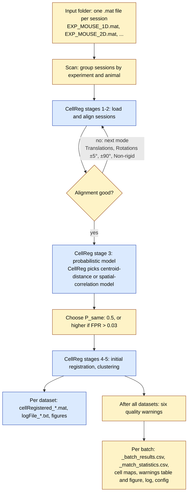

# CellRegBatch

**Batch cell registration across calcium-imaging sessions, built on [CellReg](https://github.com/zivlab/CellReg).**

CellRegBatch runs CellReg on many animals in one go. You point it at a folder
of session files. It groups the sessions by animal into datasets, registers
each dataset with CellReg, flags the datasets whose registration looks
unreliable, and writes summary tables.

> **Credit.** The cell-registration method and most of the code in this
> repository are **CellReg**, by Liron Sheintuch, Yaniv Ziv and colleagues
> (Ziv lab, Weizmann Institute of Science). This repository is a fork of
> [zivlab/CellReg](https://github.com/zivlab/CellReg) v1.6.0. We add a batch
> layer and a GUI for it on top. We do not change the registration
> algorithm. **If you use CellRegBatch, please cite the CellReg paper**
> (see [How to cite](#how-to-cite)).

## What the batch layer adds

CellReg registers one animal at a time, and its GUI asks the user to make a
choice at each stage. That is a good way to check one animal carefully. It is
slow for a study with dozens of animals. CellRegBatch makes those choices with
fixed rules and records each one:

- **Folder scan.** It reads the experiment, animal and session from each file
  name (for example `CC_H02_1D.mat`). All sessions of one animal form a
  dataset.
- **No dialogs.** It runs CellReg stages 1–5 for each dataset without user
  input. If one dataset fails, it records the error and continues with the
  next.
- **Alignment fallback.** If an alignment mode gives a poor result, it tries
  the next one: Translations → Translations and Rotations (±5°) → ±90° →
  Non-rigid.
- **Missing sessions.** You set the number of sessions per animal. An animal
  with fewer sessions is still registered and gets a red warning. Its cell map
  has a column of zeros for each missing session, so all maps of a batch have
  the same columns.
- **Automatic P_same threshold.** It keeps the CellReg default of 0.5. It
  raises the threshold only when the estimated false-positive rate is above a
  target (0.03 by default).
- **Model choice.** By default CellReg chooses the model with the better fit.
  You can set one model for all animals instead.
- **Quality warnings.** Six warnings per dataset: Sessions, Few cells, Cell
  drop, Alignment, Model fit, Low match. Each is red, yellow or none. Low match
  also finds a session that hardly connects to the others, and compares the
  dataset with the batch median (robust to one bad dataset).
- **Outputs.** For each dataset you get the usual CellReg outputs
  (`cellRegistered_*.mat`, `logFile_*.txt`, all stage figures) and the cell
  map as a CSV file. For the batch you get a results table, a table of cells
  found in 1…S sessions, a warnings table, a picture of all warnings, a log
  and the exact config.
- **GUI.** Three tabs: Setup, Parameters, Run & Results, with a **?** button
  next to each field. The GUI can reload a saved results table.

Blue boxes are CellReg code. Yellow boxes are the batch layer.

## Quick start

1. Clone the repository:
   `git clone https://github.com/iabs-neuro/CellRegBatch.git`
2. In MATLAB, go to the repository folder.
3. Start the GUI: `run BatchCellReg_GUI/BatchCellReg.m`
4. On the **Setup** tab, select the folder with your session files. Click
   **Scan**. Set **Expected sessions per mouse**.
5. On the **Parameters** tab, set **Microns per pixel** for your microscope.
6. On the **Run & Results** tab, click **Run batch**.

The results go to the `Matching` subfolder of the input folder.

To try the tool first on the sample data that comes with CellReg, follow the
[Guide](Docs/GUIDE.md). It takes about 5 minutes.

## Documentation

| Document | Contents |
|---|---|
| [Guide](Docs/GUIDE.md) | Step by step: install, run the sample data, run your data, read the results. Start here. |
| [Руководство (Guide in Russian)](Docs/GUIDE_ru.md) | The same guide in Russian. |
| [Manual](Docs/MANUAL.md) | Reference: file naming, all parameters, the pipeline in detail, output files and columns, every warning, scripting, tests, known limitations. |
| [Справочник (Manual in Russian)](Docs/MANUAL_ru.md) | The same manual in Russian. |
| [CellReg User Manual](Docs/User%20Manual.docx) | The original CellReg manual by the Ziv lab. It explains the method and the CellReg GUI. |

## Requirements

- MATLAB R2020a or newer. We run the tests on R2020a and R2025b (Windows), and
  GitHub Actions runs them on Linux, Windows and macOS. We checked the GUI on
  R2025b on Windows.
- Image Processing Toolbox, Statistics and Machine Learning Toolbox and
  Optimization Toolbox. CellReg needs them.
- Parallel Computing Toolbox is optional. It speeds up alignment. Without it,
  turn off **Use parallel processing** on the Parameters tab.

## Input

One `.mat` file per session. The first variable in the file is the array of
spatial footprints, size N×Y×X (cells × height × width). This is the CellReg
input format. File names must follow the pattern
`<EXPERIMENT>_<ANIMAL>_<SESSION>...mat`, for example `CC_H02_1D_filters.mat`.
The [Manual](Docs/MANUAL.md#1-input-files) gives the exact rule. The `Helper`
folder has CellReg's converters from Suite2p, CNMF-E and Inscopix outputs.

## The original CellReg tools are still here

This fork keeps the full CellReg package:

- the CellReg GUI: `GUI/CellReg.m`;
- the CellReg API example: `CellReg/demo.m`;
- the sample data and sample results: `SampleData/`;
- the CellReg setup script: `CellReg_setup.m`. It adds the CellReg folders to
  the MATLAB path and saves the path.

Use the CellReg GUI when you want to inspect one animal by hand. For questions
about the method or the CellReg GUI, see the
[CellReg repository](https://github.com/zivlab/CellReg).

## Changes to the original CellReg code

We changed one CellReg file:

- `CellReg/align_images.m`: five blocking `warndlg` dialogs are commented
  out, because a modal dialog stops an unattended batch. Each dialog already
  had an equal `warning()` on the line above, so the message still goes to the
  MATLAB console. The file header records the change.

All other files in `CellReg/`, `GUI/`, `Helper/`, `SampleData/` and
`Docs/User Manual.docx` are as in CellReg v1.6.0. The batch layer is in
`BatchCellReg/`, `BatchCellReg_GUI/` and `tests/`.

## How to cite

Please cite the CellReg paper. It describes the method that does the
registration:

> Sheintuch, L., Rubin, A., Brande-Eilat, N., Geva, N., Sadeh, N., Pinchasof,
> O., & Ziv, Y. (2017). Tracking the same neurons across multiple days in Ca²⁺
> imaging data. *Cell Reports*, 21(4), 1102–1115.
> https://doi.org/10.1016/j.celrep.2017.10.013

If the batch layer matters for your methods (for example the automatic P_same
rule or the quality checks), you can also cite this repository:
`https://github.com/iabs-neuro/CellRegBatch`. GitHub's **Cite this
repository** button uses [`CITATION.cff`](CITATION.cff).

## License

GNU General Public License v2 ([LICENSE.txt](LICENSE.txt)), the same license
as CellReg. The batch layer is released under the same license.

## Authors and contact

- **CellReg** (method and core code): Ziv lab, Weizmann Institute of Science.
  See [zivlab/CellReg](https://github.com/zivlab/CellReg).
- **Batch layer**: Viktor Plusnin, Lab of Neuronal Intelligence, Institute
  for Advanced Brain Studies, Lomonosov Moscow State University.

Report problems with the batch layer in the
[issues](https://github.com/iabs-neuro/CellRegBatch/issues) of this
repository. Problems that also happen in the original CellReg GUI belong to
the [CellReg repository](https://github.com/zivlab/CellReg/issues).
